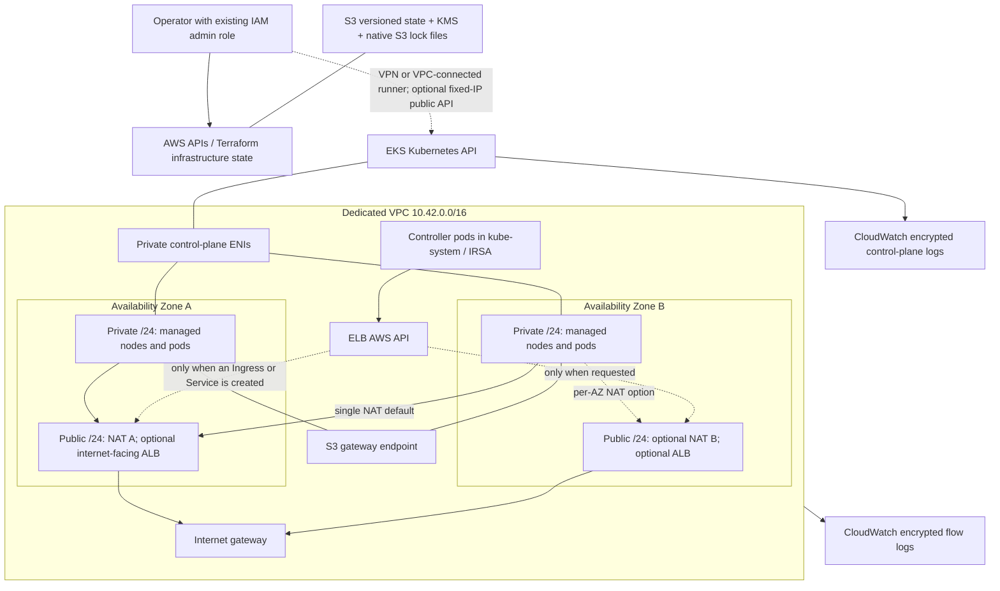

# AWS EKS infrastructure with Terraform

An independently deployable DevOps portfolio project by Ashhad Ali. This adds a Kubernetes foundation to the existing showcase without changing its earlier Jenkins, EC2, Kubernetes or monitoring examples.

**Status:** production-oriented reference implementation, not a claim of production certification. No AWS resources have been provisioned during authoring. See [validation evidence](docs/validation.md) for exactly what was tested.

## What this demonstrates

- Two-AZ VPC, public load-balancer/NAT subnets and private EKS subnets, S3 gateway endpoint, encrypted VPC flow logs and a closed default security group.
- EKS 1.35, API-based access entries, no implicit cluster-creator administrator, private API by default, all five control-plane logs and customer-managed KMS secrets encryption.
- AL2023 managed node groups with configurable capacity, encrypted gp3 disks, IMDSv2, no SSH and separate CNI/controller workload IAM roles.
- Separate Terraform states for infrastructure and the Helm-installed AWS Load Balancer Controller, so Kubernetes connectivity is not needed during infrastructure creation.
- Credential-free CI: format, provider-schema validation, mocked Terraform plan tests, TFLint and Checkov. CI never runs apply or requests AWS credentials.

## Architecture



EKS manages the control plane outside your VPC and places private ENIs inside it. The diagram's ALB is conditional: installing the controller does **not** create an ALB. Private subnets also support internal load-balancer discovery. AWS places managed nodes across the group's subnets; two nodes do not guarantee one node in each AZ. Application topology spread, replicas and disruption budgets are still needed.

## Repository layout

| Path | Responsibility |
|---|---|
| `bootstrap/` | Protected, versioned, KMS-encrypted S3 state bucket |
| `modules/network/` | Subnets, routes, NAT, S3 endpoint, flow logs |
| `modules/eks/` | Cluster, access, node groups, security groups, CNI/controller IAM |
| `modules/log-group/` | Reusable KMS-encrypted CloudWatch log group |
| `environments/portfolio/` | Complete configurable environment; infrastructure state |
| `addons/` | Matching versioned controller Helm release; separate state |
| `docs/` | Security, operating instructions, cost model and interview tradeoffs |

Run commands from **this directory** (`projects/aws-eks`), never the older repository-level `infrastructure/` example. Existing resources are not imported or modified by this project.

## Prerequisites and assumptions

- Commercial AWS partition, dedicated sandbox account, two or three available AZs, non-overlapping IPv4 /16 VPC. Defaults target `us-east-1` and EKS 1.35; confirm regional version availability before planning.
- Terraform 1.13.4 or newer (<2), AWS CLI v2, kubectl compatible with your Kubernetes minor version, and an active short-lived AWS SSO/assumed-role session. Helm CLI is useful for diagnostics but the provider installs the controller.
- An **existing** assumable IAM role for EKS administration. The Terraform operator must have permissions for VPC, EKS, IAM/pass-role, KMS, CloudWatch and S3 bootstrap. The project intentionally does not mint a broadly privileged deployment identity.
- A VPC-connected operator/runner or VPN for the private Kubernetes API. Network connectivity and EKS IAM authorization are separate requirements. Configure a private API ingress CIDR as described below, or explicitly allow your fixed public `/32` for a temporary sandbox deployment.
- Account quotas, budget alerts and deployment approval remain operator responsibilities. Never copy real credentials into tfvars, workflow secrets or Git history for this project.

## Validate locally without AWS

```bash
terraform fmt -check -recursive
for dir in bootstrap environments/portfolio addons modules/network modules/eks; do
  terraform -chdir="$dir" init -backend=false -input=false
  terraform -chdir="$dir" validate
done
terraform -chdir=modules/network test
terraform -chdir=modules/eks test
tflint --init
tflint --recursive --config="$(pwd)/.tflint.hcl"
checkov -d . --config-file .checkov.yml
```

These are Bash examples (Git Bash/WSL/Linux/macOS). PowerShell users can run each `-chdir` command individually. `init -backend=false` still downloads providers but never contacts your S3 backend. Mock tests test planned resource properties, **not** AWS runtime behavior.

## Deploy deliberately

The following commands create billable resources. They are documented for a future, approved sandbox deployment; authoring/CI does not execute them.

1. Authenticate with SSO, inspect `aws sts get-caller-identity`, and verify the intended account/region. Create a scoped administrator role through your normal IAM process if needed.
2. Bootstrap state. Choose a globally unique bucket name and supply account ID:

```bash
terraform -chdir=bootstrap init
terraform -chdir=bootstrap plan -var='account_id=123456789012' -var='bucket_name=YOUR-UNIQUE-STATE-BUCKET' -out=bootstrap.tfplan
terraform -chdir=bootstrap apply bootstrap.tfplan
terraform -chdir=bootstrap output
```

Bootstrap initially uses local state. Keep it encrypted, backed up and outside Git. For team use, migrate bootstrap state into the bucket under a **different key**, following [the state runbook](docs/operations.md). Do not discard bootstrap state.

3. Copy `environments/portfolio/terraform.tfvars.example` to `terraform.tfvars` and `backend.hcl.example` to `backend.hcl` **inside that directory**. Replace account/role/bucket/KMS values. Keep the same region as your AZs. Empty `public_access_cidrs` keeps the API private. For VPN/runner access, set `private_access_cidrs` to its private source range; routing/VPN itself is external to this project.

```bash
terraform -chdir=environments/portfolio init -backend-config=backend.hcl
terraform -chdir=environments/portfolio plan -out=infrastructure.tfplan
# Inspect account, resource counts, security groups and resolved add-on versions.
terraform -chdir=environments/portfolio apply infrastructure.tfplan
terraform -chdir=environments/portfolio output
```

Record the resolved CNI/CoreDNS/kube-proxy versions into `addon_versions` after initial compatibility review. The first plan chooses AWS's default compatible builds, not the latest; the dependency lock file does not lock EKS add-on builds or AL2023 AMI release selection. Review all subsequent upgrade plans. See [operations](docs/operations.md).

4. From a host that can reach the API, use an operator profile allowed to assume the administrator role. Run the `configure_kubectl` output and check `kubectl get nodes`; its `--role-arn` option makes kubectl authenticate by assuming that role. Do not use this option from a session already assuming the same role unless its trust policy allows self-assumption. Private access additionally needs the ingress allowlist above.
5. Copy both examples in `addons/`, use the infrastructure outputs for `cluster_name`, `vpc_id`, `controller_role_arn`, and a distinct `addons.tfstate` key. For this stage, establish an administrator-role session with `AWS_PROFILE` or your organization's role workflow. The **current AWS session used by Helm's exec authentication must be the EKS administrator role**; infrastructure IAM permissions alone do not grant Kubernetes access. That role also needs AWS `eks:DescribeCluster` and access to the add-ons state prefix/KMS key; EKS access policies grant Kubernetes permissions, not those AWS API permissions.

```bash
terraform -chdir=addons init -backend-config=backend.hcl
terraform -chdir=addons plan -out=addons.tfplan
terraform -chdir=addons apply addons.tfplan
kubectl -n kube-system rollout status deployment/aws-load-balancer-controller
```

No workloads, public endpoints, DNS records or certificates are created. A future ingress must explicitly request its class/scheme and HTTPS certificate. Never expose a sample application just to demonstrate that the controller installed.

## Destroy in dependency order

1. Delete application Ingress, Gateway and LoadBalancer Service resources **while the controller still runs**. Wait for finalizers and confirm all ALB/NLB/target groups/controller-managed security groups are gone in AWS.
2. `terraform -chdir=addons plan -destroy -out=destroy.tfplan`, inspect it, then `terraform -chdir=addons apply destroy.tfplan` from an API-connected authorized host.
3. `terraform -chdir=environments/portfolio plan -destroy -out=destroy.tfplan`, inspect it, then apply that saved plan. Check for residual ENIs/EIPs, volumes and load balancers if VPC deletion blocks.
4. Retain the state bucket and bootstrap state. Bucket/key destruction is deliberately protected and requires a separate retention/recovery decision. KMS keys scheduled for deletion remain pending for 30 days. Do not disable a key while retained encrypted logs/state are still needed.

## Costs and boundaries

This is **not a free-tier project**. The default keeps one NAT and two small on-demand nodes; there is no autoscaler or automatic shutdown. See the [cost model](docs/costs.md): a rough low-traffic planning allowance is **USD 180–250/month before tax** for continuously running defaults, excluding any ALB, VPN, substantial transfer/logging or support charges. It is an estimate, not a quote; verify live regional rates in AWS Pricing Calculator. Destroy the cluster after a learning session.

For production, use per-AZ NAT, appropriate instance sizing, private access connectivity, tested upgrades/recovery and workload security/observability. [Security decisions](docs/security.md), [interview tradeoffs](docs/tradeoffs.md) and [validation limitations](docs/validation.md) explain the engineering choices and what still needs runtime evidence.
